##  Space Design game - "ASTRIX"
A realistic, browser-based space design and exploration game that makes spacecraft and mission design accessible to everyone.
## 2. Team Details

**Team Name:** "TEAM DECODERS"

| # | Full Name | Home Institution | GitHub Username | Role |
|---|-----------|------------------|-----------------|------|
| 1 | Chaitanya Gajbhiye | Priyadarshini College | [gajbhiyechaitanya25-star](https://github.com/gajbhiyechaitanya25-star) | Team leader, Game designer, prompter |
| 2 | Aditya ghonge | Priyadarshini College | [adityaghonge18-dot](https://github.com/adityaghonge18-dot) | backened |
| 3 | Arhan Raut | YCCE | [rautarhan21-star](https://github.com/rautarhan21-star) | documentation |
## 3. Solution Overview & Architecture

### Solution Overview
ASTRIX is a browser-based 3D space design and exploration game. The whole game runs from a single HTML file, so there is no installation or backend.

**Key Features:**
- Pilot a Boeing/NASA X-37 spacecraft with flight controls, afterburner and RCS strafing
- Explore the Sun, planets, major moons (Moon, Europa, Titan, Enceladus, Ganymede, Callisto and more) and Pluto
- Seamless zoom from spacecraft → planets → solar system → Milky Way → galaxies
- NASA-style Entry-Descent-Landing sequence, surface walking and re-boarding the ship
- Customizable astronaut (real NASA astronaut presets, suits, visors, backpacks) and ship liveries
- Missions, achievements, a Space Journal, planet scanning and a 360° planet inspector
- A space knowledge quiz that appears every minute
- Solar System Warp Map, rebindable keys and progress saved in the browser

### System Architecture Diagram

```mermaid
flowchart TD
    A[Player - Browser] --> B[index.html]
    B --> C[React 19 UI Layer]
    B --> D[Three.js 3D Engine]
    C --> C1[HUD, Menus, Tutorial]
    C --> C2[Missions, Quiz, Journal]
    C --> C3[Avatar and Ship Customization]
    D --> E[Scene: Planets, Moons, Galaxies]
    D --> F[X-37 Spacecraft and Astronaut]
    G[Keyboard / Joystick Input] --> H[Flight and Surface Physics]
    H --> D
    C2 --> I[(localStorage - saved progress)]
    J[esm.sh CDN + Google Fonts] --> B
```



### Technology Stack

| Layer | Technology |
|-------|------------|
| UI | React 19, Tailwind CSS v4, lucide-react icons |
| 3D Engine | Three.js (WebGL) |
| Language | JavaScript (ES modules, JSX compiled) |
| Libraries loaded via | Import map from the esm.sh CDN |
| Fonts | Google Fonts (Chakra Petch, JetBrains Mono, Plus Jakarta Sans) |
| Storage | Browser localStorage |
| Hosting | GitHub Pages |

## Live demo and screenshots
open this link - https://drive.google.com/drive/folders/1D5v-2Ut8-kUOUdq6DmMMszLSjbkIOjOn

## 5. Installation & Setup Guide

### Prerequisites
- A modern browser with WebGL (Chrome, Edge, Firefox)
- An internet connection, because React, Three.js and fonts load from CDNs
- Git, plus Python 3 or VS Code Live Server (optional, for a local server)

### Step 1: Clone
```bash
git clone https://github.com/gajbhiyechaitanya25-star/space design game.git
cd space-design-game
```

### Step 2: Dependencies
There is nothing to install. The whole game is one file, `index.html`.

### Step 3: Run locally
```bash
python -m http.server 8000
```
Open `http://localhost:8000`. You can also use VS Code's **Live Server** extension.

### Controls

| Key | Action |
|-----|--------|
| W / S | Thrust forward / reverse (walk on surface) |
| A / D | Turn left / right |
| Q / E | RCS strafe left / right |
| R / F | Pitch nose up / down |
| Shift | Afterburner / sprint |
| Space | EVA jump / full brake |
| V | Scan planet |
| Enter | Start NASA landing |
| B | Board the X-37 from the surface |
| G | Open Solar System Warp Map |
| Scroll or + / - | Zoom between scales |

Keys can be rebound in the in-game customization menu.

### Troubleshooting
- **Black screen or stuck loading:** check your internet connection, because the libraries load from esm.sh.
- **Low FPS:** close other tabs and enable hardware acceleration in your browser.
