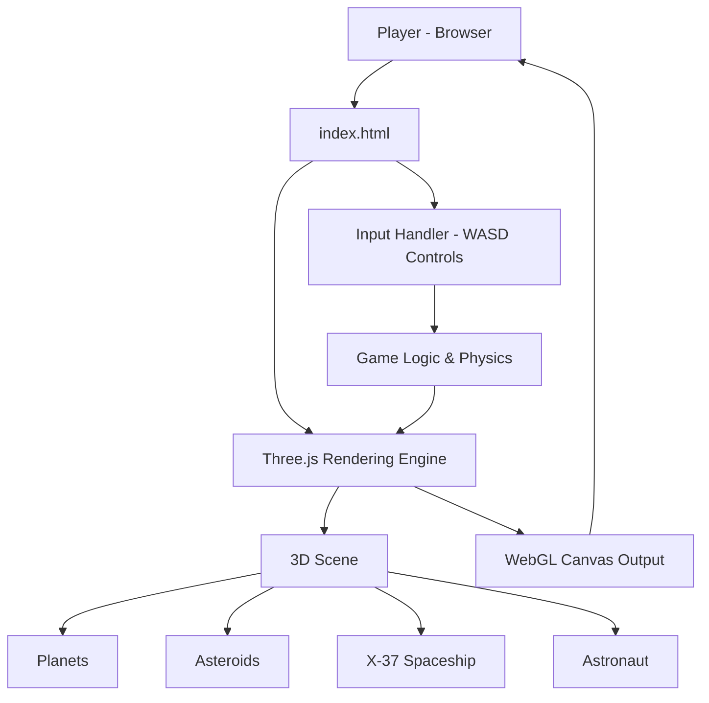

##  Space Design game - "ASTRIX"
A realistic, browser-based space design and exploration game that makes spacecraft and mission design accessible to everyone.
## 2. Team Details

**Team Name:** "TEAM DECODERS"

| # | Full Name | Home Institution | GitHub Username | Role |
|---|-----------|------------------|-----------------|------|
| 1 | Chaitanya Gajbhiye | Priyadarshini College | [gajbhiyechaitanya25-star](https://github.com/gajbhiyechaitanya25-star) | Team leader, Game designer, prompter |
| 2 | Aditya ghonge | Priyadarshini College | [adityaghonge18-dot](https://github.com/adityaghonge18-dot) | backened |
| 3 | Arhan Raut | YCCE | [rautarhan21-star](https://github.com/rautarhan21-star) | documentation |
## 3. Solution Overview & Architecture

### Solution Overview
ASTRIX is a browser-based 3D space design and exploration game. The whole game runs from a single HTML file, so there is no installation or backend.

**Key Features:**
- Pilot a Boeing/NASA X-37 spacecraft with flight controls, afterburner and RCS strafing
- Explore the Sun, planets, major moons (Moon, Europa, Titan, Enceladus, Ganymede, Callisto and more) and Pluto
- Seamless zoom from spacecraft → planets → solar system → Milky Way → galaxies
- NASA-style Entry-Descent-Landing sequence, surface walking and re-boarding the ship
- Customizable astronaut (real NASA astronaut presets, suits, visors, backpacks) and ship liveries
- Missions, achievements, a Space Journal, planet scanning and a 360° planet inspector
- A space knowledge quiz that appears every minute
- Solar System Warp Map, rebindable keys and progress saved in the browser

### System Architecture Diagram

### Technology Stack

| Layer | Technology |
|-------|------------|
| Frontend | HTML5, CSS3, JavaScript (ES6) |
| 3D Engine | Three.js (WebGL) |
| Controls | Keyboard events (WASD) |
| Hosting | GitHub Pages |
| Version Control | Git & GitHub |
| Development Tools | VS Code, AI assistance (see Section 6) |

## Live demo and screenshots
open this link - https://drive.google.com/drive/folders/1D5v-2Ut8-kUOUdq6DmMMszLSjbkIOjOn
