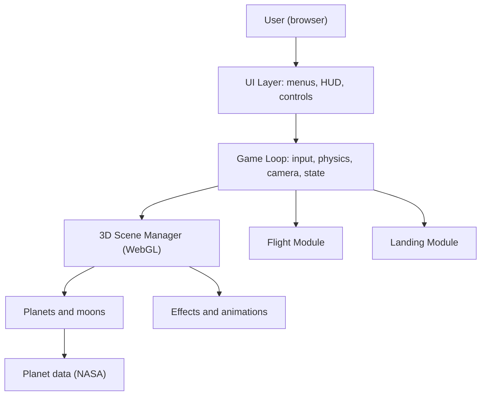

# Space Design Game "ASTRIX"
Design your own universe in this creative space game\! 🚀 Build futuristic spaceships, customize planets, decorate space stations, and create stunning galaxies. Explore endless possibilities, unleash your imagination, and bring your dream universe to life among the stars\! 🌌
## Team Details
**Team Name:** TEAM DECODERS
| Name | Role | GitHub | Email |
|------|------|--------|-------|
| Chaitanya Gajbhiye | Team Lead / Frontend | [@gajbhiyechaitanya25-star](https://github.com/username1) | chaitanyagajbhiye25@gmail.com |
| Aditya Ghonge | Backend | [@adityaghonge18-dot](https://github.com/username2) | adityaghonge18@gmail.com |
| Arhan Raut | Documentation | [@rautarhan21-star](https://github.com/username3) | arhanraut97@email.com |
## Solution Overview
Astrix is a browser-based 3D simulator of the NASA solar system. Users fly an X-37-style spaceplaneview planets in 360°, and watch atmospheric landings
## Functional Explanation
| Module | Description |
|--------|-------------|
| Solar System Engine | Planets, moons and Pluto with orbital motion |
| Spaceplane Flight | Player pilots the X-37-style ship |
| 360° Planet View | Rotate around and inspect each planet |
| Landing Sequence | Entry, descent and touchdown animation |

## System Architecture

## Tech Stack
| Area | Technology |
|------|------------|
| Frontend | HTML, CSS, JavaScript |
| 3D Engine | Three.js (WebGL) |
| Build Tool | Vite |
| Data | NASA planetary data |
| Version Control | GitHub 
